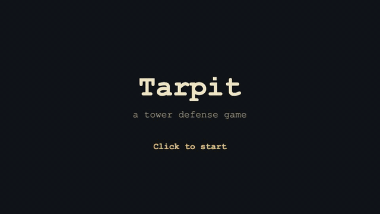

# Tarpit

[](https://github.com/Ancap08/tarpit/actions/workflows/ci.yml)

**Play it: https://ancap08.github.io/tarpit/**

A small browser tower defense game, built by AI agents under human direction.



## What this is

A portfolio project. The point is how a human steered AI agents to build a
real game from an empty folder; the playable game is the proof. It was made
for Kyle and his nieces and nephews: one map, ten waves, three towers, three
enemies, simple shapes with labels.

## How to play

1. Pick a tower on the build bar under the map: Musketeer (single target), Cannon (splash) or Tar Pit (slow). Move over the map: a green square and a ghost with its range show where it can go; red means it cannot. Click to build, and keep clicking to place more; click the button again or press Escape to stop. Click a tower to upgrade or sell it.
2. Press Start Wave. Enemies walk from the cave to the cottage; each one that gets through costs a life.
3. Kills and cleared waves pay gold. Survive all 10 waves to win. The 1x/2x button sets the speed.

## How it was built

- **Kyle** set the design, approved the plan and scope, and merged PR 1 himself. He then had the coordinator merge each PR once checks and the verifier passed, with screenshots and play feel left to his review.
- **Coordinator: Claude Fable 5.1.** Wrote the scope, design spec and briefs, ran the repo settings, and never wrote game code.
- **Implementers: Claude Opus at medium effort.** Wrote each milestone's code, tests and notes.
- **Verifier: Claude Sonnet**, a different model, checked every milestone PR before merge from a clean install (the one non-milestone PR, the baseline workflow, was reviewed as part of milestone 3), re-derived numbers by hand and added its own tests.
- **One PR per milestone.** Every PR runs lint, typecheck, Vitest, build, and Playwright smoke and play-through tests. Screenshot baselines are generated on CI (Linux) and committed to the PR for Kyle's review.

Every design call and who made it is in [DECISIONS.md](DECISIONS.md). What
happened, including what went wrong, is in [DEVLOG.md](DEVLOG.md).

## By the numbers

Counts at the merge of milestone 6b (PR 9), from `git` and `gh`:

| | |
|---|---|
| Pull requests merged | 9 (eight milestone PRs and one CI workflow PR) |
| Commits on `main` | 68: 59 changes and 9 merges |
| Commit co-authors | Claude Opus 29, Claude Fable 5.1 13, Claude Sonnet 12; 6 baseline commits by `github-actions[bot]` |
| Unit tests (Vitest) | 123 in 16 files |
| Browser tests (Playwright) | 39 in 8 files |
| Screenshot baselines | 8 |
| Models involved | 3 (Fable 5.1, Opus, Sonnet) |
| Time from first commit to milestone 6b merged | about 2 hours, 2026-11-21 |

## Repo map

```
README.md         this file
LICENSE           MIT
CLAUDE.md         rules for agents working in this repo
DECISIONS.md      every design and process decision, who made it and why
DEVLOG.md         how it was built, milestone by milestone, including what went wrong
docs/SCOPE.md     v1 scope and the milestone table
docs/SCOPE-v2.md  v2 scope and milestones 8 to 13
docs/DESIGN.md    the game spec: map, economy, enemies, towers, waves
docs/media/       README GIF and still
src/sim/          game logic in plain TypeScript, no Phaser or DOM (lint-enforced)
src/sim/grid.ts   the build grid: cells, cell centres, the buildable rule
src/game/         Phaser rendering, input, HUD, tower panel and the ?test=1 test hooks
src/game/ui/buildBar.ts  the HUD build bar: pick a tower, then click a cell
scripts/          npm run sim (balance report) and npm run demo (GIF recorder)
e2e/              Playwright tests and CI screenshot baselines
.github/workflows CI checks, Pages deploy, screenshot baseline update
```

## Run locally

Requires Node 22 and npm.

```sh
npm install                        # install dependencies
npx playwright install chromium    # one time, for e2e tests and the demo
npm run dev                        # dev server at http://localhost:5173
```

Checks (CI runs all five):

```sh
npm run lint        # ESLint, including the src/sim boundary rule
npm run typecheck   # tsc --noEmit over src/, e2e/, scripts/ and config files
npm test            # Vitest unit tests
npm run build       # production build into dist/
npm run test:e2e    # Playwright against the built dist/ (run build first)
```

Other tools:

```sh
npm run sim         # headless balance report: each archetype build, wave by wave
npm run demo        # rebuild, play in real time, write docs/media/tarpit.gif and .png (needs ffmpeg)
```

Open the game with `?test=1` to freeze time and expose test hooks on
`window.__tarpit` (see `src/game/testGlobal.d.ts`). Screenshot baselines are
generated only on CI: run the **Update screenshot baselines** workflow
(`gh workflow run update-snapshots.yml -f ref=<branch>`); local runs skip the
pixel comparison because macOS renders text differently.

## Status and what is out of scope

v1 is complete: milestones 0 to 6 are merged and the build is live. Milestone
7's evidence is Kyle finishing a game from the public link.

v2 is in progress ([docs/SCOPE-v2.md](docs/SCOPE-v2.md)). Milestone 8 moved
tower placement in the simulation to a 30 x 15 grid of 32 px cells.
Milestone 9 replaced the ten v1 build spots with build-anywhere: a build bar
in the HUD, a ghost tower with its range, and a 960 x 580 canvas. The README
GIF still shows the v1 build menu until milestone 13 records a new one.

Out of scope for v1: multiple maps, saves, sound, menus beyond start and
restart, mobile layout, multiplayer, custom art. A Kenney CC0 art pack is a
possible next step.

Further reading: [docs/SCOPE.md](docs/SCOPE.md),
[docs/DESIGN.md](docs/DESIGN.md), [DECISIONS.md](DECISIONS.md),
[DEVLOG.md](DEVLOG.md).
