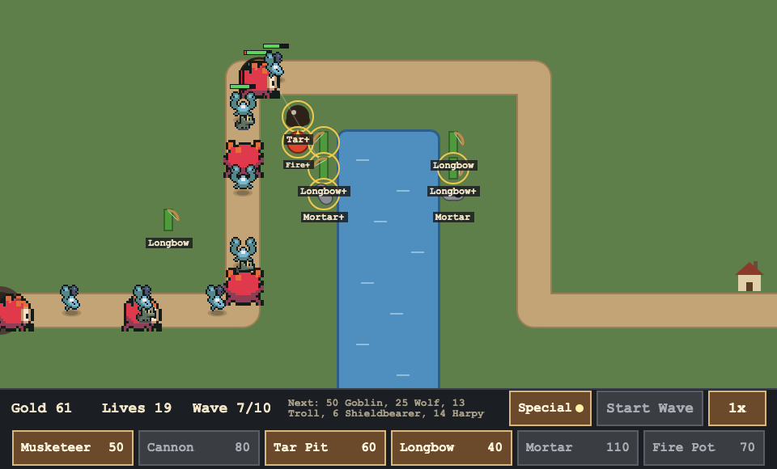
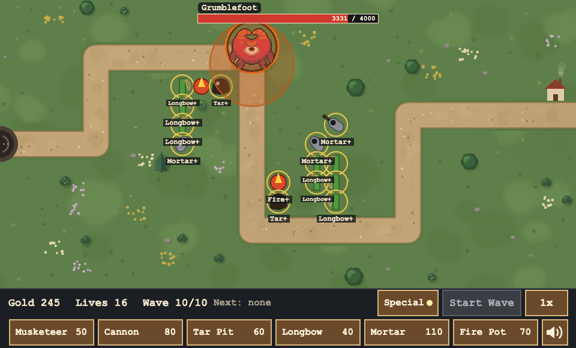

# Tarpit

[](https://github.com/Ancap08/tarpit/actions/workflows/ci.yml)

**Play it: https://ancap08.github.io/tarpit/**

A small browser tower defense game, built by AI agents under human direction.


## What this is

A portfolio project. The point is how a human steered AI agents to build a
real game from an empty folder; the playable game is the proof. It was made
for Kyle and his nieces and nephews.

The game has three maps, twenty campaign waves and then endless waves, six
towers you can build on any free grass cell (not on the path, the river or
the cottage), five enemy types (one of
them flies, one carries a shield) and two bosses, three difficulty levels, three
special attacks, and play on a tablet. The enemies are placeholder pixel
sprites; towers and the HUD are simple shapes with labels, and the maps are
drawn in code, until the art pass (see Status). Shots fly as musket balls, arrows,
cannonballs, mortar shells, tar globs and gouts of fire; towers turn and
kick back, kills drop floating gold, and banners mark new waves and boss arrivals.
The maps are alive: textured grass and a worn dirt trail, trees and bushes
that clear when you build on them, a flowing river, chimney smoke, drifting
cloud shadows and the odd bird or butterfly, all still under reduced motion.

## How to play

1. **Title.** Pick a difficulty (Easy, Normal or Hard: enemy hp, starting
   gold and lives) and a map (Meadow, Switchback or Riverbend), then press
   Play (Enter or Space also work). The title shows your best score for that
   map and difficulty once you have one.
2. **Build.** Drag a tower from the build bar under the map onto a green
   cell: a ghost shows the tower and its range, and red means it cannot go
   there. You can also click a tower on the bar and then click cells; the
   pick stays until you click the button again, press Escape, click a
   tower, or can no longer afford it. The six
   towers: Musketeer (single target), Cannon (splash), Tar Pit (slows),
   Longbow (cheap, long range), Mortar (long-range splash) and Fire Pot
   (burns).
3. **Plan.** Until you press Start Wave, everything you bought between
   waves is free to change (a tower bought while a wave runs locks at once): drag a tower (dashed outline) to another
   cell, Remove it for all its gold back, or Undo an upgrade for its full
   price. Once the wave starts, towers are locked in place and sell for 70%.
4. **Upgrade, sell, target.** Open a tower's panel and choose Upgrade to
   reach level 2. At level 2, choose one of two paths to reach level 3.
   Each choice shows its price and describes the shot, blast, slow or burn in plain words. A gold diamond or
   two blue dots beside the tower show which path you bought. During
   planning, Undo upgrade refunds purchases from that round one at a
   time, starting with the latest. The panel also shows the tower's kills
   and lets you sell it or cycle its target through First, Last and Strongest.
5. **Tar and fire.** A Fire Pot's burn does double damage to an enemy slowed
   by tar, so build a Tar Pit and a Fire Pot side by side.
6. **Mortar.** It cannot hit enemies inside its dashed inner circle (70 px),
   so put it back from the path it guards.
7. **Enemies.** Goblins, fast Wolves, tough Trolls, flying Harpies (the Tar
   Pit, Cannon and Mortar cannot hit them, and a Fire Pot's burn does not
   stick to them) and Shieldbearers (small shots do
   half damage). Each one that reaches the cottage costs a life.
8. **Specials.** The charge is ready when a wave starts and refills 20 s
   after each use, so you can fire several in a wave. Press Special (left of
   Start Wave), pick a special if more than one is unlocked, and click the
   trail where the circle covers the enemies; a banner says what to do, and
   Escape or Special again cancels. Powder Keg (from wave 1) blasts them, Tar
   Barrel (from wave 4) leaves a puddle that slows everything in it for 11 s,
   Fire Arrows (from wave 7) leave a burning patch for 11 s. A label shows how
   many it caught, and the button shows the seconds until the next one.
9. **Call next.** Once every enemy of a wave has come out of the cave
   (some may still be walking), Start Wave reads "Call
   next +N". Press it to send the next wave now: you get the wave's clear
   bonus at once plus up to 20 gold. In the campaign, early calls are
   blocked into and out of waves 5, 10, 15 and 20.
10. **Pick a reward.** After waves 5, 10 and 15, click or tap one of
    three cards, or press 1, 2 or 3. Hover over or tap a reward icon in
    the HUD to read what it does. War Chest gives 80 gold and Stone Walls
    adds four lives when picked. You keep your rewards in endless play.
    Turning your device keeps your run and any open reward cards.
    Reloading starts a new run.
11. **Two bosses.** Grumblefoot, the Troll King, arrives at the end of
    wave 10 and costs 5 lives if he gets through. Act II begins on wave 11.
    On Normal and Hard, enemies gain health each wave through wave 20.
    Grumblemaw arrives at the end of wave 20 and costs 10 lives if he gets
    through. When his health falls past two thirds and one third, he calls
    Wolves from the cave. The health bar shows which boss is on the trail.
12. **Win, then keep going.** Survive wave 20 to win. Choose Keep going,
    then press Start Wave to play wave 21. Endless waves get tougher until
    you lose. Your browser saves your best score (waves cleared) per map
    and difficulty.
    Tap the speed button for 1x or 2x; hold it for 3x while held. Tap the
    Gold number five times quickly for 500 gold (that game then saves no
    best score).
13. **Phone or iPad.** Hold it either way: a tall screen turns the map so
    the trail runs top to bottom with the buttons under it in thumb reach,
    and turning the device mid-game keeps the game. Tap a cell once to aim,
    tap it again to build; when you drag, the ghost floats above your
    finger. Tap the × to close a tower's panel. For a special, tap where it
    should land, or hold to see the circle above your finger and let go to
    fire.
    On touch a ghost over a blocked cell moves to a free cell beside it on the
    same side of the trail, and a tap beside a tower selects it.

**Install it.** On iPhone and iPad: open the game in Safari, tap Share, then Add to Home Screen.
On Android: open it in Chrome, open the menu, then Install app.
After the first visit it plays offline; best scores stay on the device.

**Sound.** Every action has a short retro sound, made in code (no audio files); it starts on your first tap or click.
The speaker button on the title and in the game, or the M key, mutes it; the choice is remembered.





## How it was built

- **Kyle** set the direction, approved each scope (v2, v3, v4, and the v4
  additions from his iPad play notes) and merged PR 1 himself. For the v1
  build run he then had the coordinator merge each PR once the `ci` check
  and the verifier passed (DECISIONS, "after milestone 0"). GitHub shows his
  account, `Ancap08`, as the merger of every PR because the coordinator used
  his `gh` login (DECISIONS, "milestone 7"), so GitHub cannot show who
  pressed merge. His iPad play notes ("we got the idea correct; now make it
  fun") added drag placement with a planning phase, special attacks and
  hordes to v4.
- **Coordinator: Claude Fable.** Wrote the scopes, the design spec and every
  brief, ran the repo settings, recorded decisions, and wrote no game code.
  The commit trailers read Fable 5.1 through the milestone 23 verification
  and Fable 5.2 from commit `0f6a69d` (the record of the milestone 23 CI
  failure, in PR 24) on; DECISIONS has no entry for the switch.
- **Implementers: Claude Opus at medium effort.** Wrote each milestone's
  code, tests and notes.
- **Verifiers: a different model from the implementer, every milestone.**
  Claude Sonnet through milestone 16 (v1 to v3), Claude Fable from
  milestone 22 to 28 (DECISIONS, "milestone 22"), Claude Sonnet again for
  milestone 29. In milestones 22 to 28 the coordinator and the verifier
  were both Claude Fable, in separate sessions, so the Fable trailer counts
  below mix the two roles. The CI baseline workflow (PR 4) had no separate
  verifier pass. Verifiers re-ran the checks,
  re-derived numbers with their own code, added their own tests and made
  two small game fixes themselves (the Wolf's facing in
  milestone 16, "Lives 0" instead of "Lives -1" in milestone 25).
- **One PR per milestone.** Every PR runs lint, typecheck, Vitest, build
  and Playwright (smoke, play, touch and screenshot tests); from milestone
  15 on, also the asset license check and the size budget. Screenshot baselines are generated on CI
  (Linux) by a workflow and committed to the PR by `github-actions[bot]`.
  `main` requires the `ci` check; every merged PR shows it green.
- An automated Codex review, set up on the GitHub repo, also commented on
  every PR; it reported findings on PRs 5, 12, 22 and 23. The records below
  do not discuss it.

Design calls and who made them are in [DECISIONS.md](DECISIONS.md) (two
gaps found at the v4 review are recorded there after the fact). What
happened, including what went wrong, is in [DEVLOG.md](DEVLOG.md).

### What the process caught

- **The first horde pass made waves denser, not longer.** Kyle asked for
  longer waves; the brief set no length target (the coordinator's slip). The
  verifier measured 381 s of waves against 405 s before and up to 47 enemies
  alive, and the milestone went back for a second pass. DECISIONS
  "milestone 25c"; DEVLOG "milestone 25c, Second pass".
- **The Hard hp cliff.** The first horde numbers gave the Hard Goblin 13 hp
  against the Musketeer's 12 damage, so every Musketeer opening lost Hard on
  wave 1. Now a rule, pinned by a test: in waves 1 to 10 no ordinary Hard enemy has hp 1 or 2 above a
  multiple of a tower's damage. DECISIONS "milestone 25c".
- **A flaky Play click.** The title scene is active one frame before Phaser
  makes its buttons clickable; a test clicking in that frame lost the click
  in 4 of 8 full runs. The title now reports ready at its first drawn frame
  and every spec waits for it. DECISIONS "milestone 26"; DEVLOG
  "milestone 26, Follow-up: Play click flake".
- **A CI failure the Mac never showed.** The live-loop test failed on
  GitHub's runner, which renders WebGL without a GPU. The coordinator's
  first diagnosis was wrong; the implementer traced it to Phaser's frame
  clamp. The test now runs on Canvas and checks rates. DECISIONS "CI failure
  on the boss PR".
- **The maps brief described the shapes wrongly three times.** The
  implementer built the waypoints as given, tested what was true and
  reported the difference. DECISIONS "milestone 27".
- **Whole-game tests hit the 5 s unit test limit** in three milestones in a
  row (the first two on the verifiers' Mac, the third on CI). Now one 30 s
  limit in `vitest.config.ts` and `npm run test:slow` to list slow tests.
  DECISIONS "milestone 27".
- **A scripted special policy made a build worse.** On Riverbend the combo
  build had 8 lives with its specials and 14 without. The specials now come
  from a stored per-wave search that never does worse than firing nothing.
  DECISIONS "milestone 28".
- **A kill counted twice.** The balance runner reported 525 kills of 524
  enemies when a special fired on the tick after a kill; the verifier pinned
  it as a failing test and the implementer fixed it. DEVLOG "milestone 28",
  verifier finding 3 and follow-up item 2.

## By the numbers

At the merge of milestone 28 (PR 33, commit `e191bf5`), from `git` and `gh`:

| | |
|---|---|
| Pull requests merged | 33: 28 milestone PRs, 4 scope PRs (11, 18, 21, 26) and the CI baseline workflow (PR 4) |
| Commits on `main` | 286: 37 merges (33 PR merges, 4 updates of a branch from `main`) and 249 others |
| Commit co-author trailers | Claude Opus 136, Claude Fable 5.1 36, Claude Fable 5.2 31, Claude Sonnet 25 |
| Screenshot baseline commits | 22 by `github-actions[bot]` |
| Unit tests (Vitest) | 1035 in 62 files |
| Browser tests (Playwright) | 284 in 48 files (3 skip locally: screenshot probes that need `VERIFIER_SHOTS`) |
| Screenshot baselines | 24 (23 desktop, 1 tablet) |
| Built size (`dist/`) | 1.25 MB in 4 files, against a 20 MB budget |
| First commit | 2026-11-21 06:11 UTC |
| v1 shipped (PR 10 merged) | 2026-11-21 08:30 UTC |
| v2 shipped (PR 17 merged) | 2026-11-21 10:24 UTC |
| v3 last PR (PR 22, milestone 16) | 2026-11-21 21:27 UTC |
| v4 last PR so far (PR 33, milestone 28) | 2026-11-22 07:43 UTC |

<details>
<summary>Commands behind the table</summary>

```sh
B=e191bf5
gh pr list --state merged --limit 100 --json number,title,mergedAt   # 33 PRs, titles give the kinds
git rev-list --count $B                       # 286
git rev-list --count --merges $B              # 37
git log $B --merges --format=%s | grep -vc '^Merge pull request'   # 4
git log $B --format='%(trailers:key=Co-Authored-By,valueonly)' | grep . | sed 's/ <.*//' | sort | uniq -c
git log $B --author='github-actions' --oneline | wc -l             # 22
npx vitest run                                # 1035 tests, 62 files
npx playwright test --list | tail -1          # 284 tests in 48 files
git ls-tree -r --name-only $B e2e/__screenshots__ | wc -l          # 24
npm run build && npm run check:size           # 1310834 bytes in 4 files
TZ=UTC git log $B --reverse --format=%ad --date=format-local:'%F %T' | head -1
gh pr view 10 --json mergedAt                 # and 17, 22, 33
```

One commit (`1f4e166`) carries two trailers, Opus and Fable 5.1. Every
commit that is neither a merge nor a baseline commit has a trailer.
</details>

## Repo map

```
README.md         this file
LICENSE           MIT
CLAUDE.md         rules for agents working in this repo
DECISIONS.md      every design and process decision, who made it and why
DEVLOG.md         how it was built, milestone by milestone, including what went wrong
docs/SCOPE.md     v1 scope and milestones 0 to 7
docs/SCOPE-v2.md  v2 scope and milestones 8 to 13
docs/SCOPE-v3.md  v3 scope (tablet, art spike, animation engine; its art, sound and effects milestones moved to v5)
docs/SCOPE-v4.md  v4 scope and milestones 22 to 29
docs/DESIGN.md    the frozen game spec: maps, economy, enemies, towers, specials, waves, endless, balance targets
docs/media/       README GIF and stills
docs/art/         art source spike (milestone 15): INVENTORY.md and the style mockups
assets/           enemy sprite sheets (placeholders from Ninja Adventure); MANIFEST.md lists every file's source and license
src/sim/          game logic in plain TypeScript, no Phaser or DOM (lint-enforced)
  game.ts           state, ticks, waves, call early, endless
  actions.ts        build, upgrade, sell, move, undo, targeting, specials
  map.ts, grid.ts   the three maps and the build grid
  waves.ts, enemies.ts, towers.ts, specials.ts, difficulty.ts   the numbers in docs/DESIGN.md
  headless.ts       archetype scripts for balance runs
  balance.suite.ts  every archetype on every map and level, pinned against the targets
  specialPolicy.ts  how the archetypes fire specials, as a person would
  designSpec.test.ts  checks DESIGN.md's tables against the code
src/game/         Phaser rendering, input, HUD and the window.__tarpit hooks
  TitleScene.ts     title menu: difficulty, map, best score
  GameScene.ts      play: build bar, drag, panel, specials, call early, end screens
  names.ts          every display name, keyed by internal id
  highScore.ts      the best score per map and difficulty in localStorage
  ui/               build bar, tower panel, special menu, boss bar, end screen
  anim/             enemy sprite animation from the simulation's events
  testMode.ts       ?test=1 hooks (typed in testGlobal.d.ts)
src/sw/           the offline service worker and its rules (docs/DESIGN.md, "Install and offline")
public/           web app manifest and home-screen icons (drawn by scripts/make-icons.ts)
scripts/          npm run sim, test:slow, demo, check:assets, check:size; make-icons, sw-build
e2e/              Playwright tests (desktop, tablet and phone projects) and CI screenshot baselines
.github/workflows CI checks, Pages deploy, screenshot baseline update
```

## Run locally

Requires Node 22 and npm.

```sh
npm install                        # install dependencies
npx playwright install chromium    # one time, for e2e tests and the demo
npm run dev                        # dev server at http://localhost:5173
```

Checks (CI runs all of these):

```sh
npm run lint          # ESLint, including the src/sim boundary rule
npm run check:assets  # every file in assets/ and docs/art/ is in assets/MANIFEST.md as CC0 or credited CC-BY
npm run typecheck     # tsc --noEmit
npm test              # Vitest unit tests
npm run build         # production build into dist/
npm run check:size    # after build: dist/ stays under 20 MB
npm run test:e2e      # Playwright against the built dist/ (run build first)
```

Other tools:

```sh
npm run sim           # headless balance report: every archetype on every map and level (about 40 s)
npm run test:slow     # list unit tests slower than 3 s (not in CI)
npm run demo          # rebuild, play in real time, write the GIF and stills in docs/media (needs ffmpeg)
```

The e2e tests serve the build on port 4173 and never reuse a running
server; a second checkout sets its own port: `PW_PORT=4174 npm run test:e2e`.
`npm run demo` uses port 4179 unless `PW_PORT` is set.

URL flags:

- `?test=1` freezes time and exposes test hooks on `window.__tarpit` (see
  `src/game/testGlobal.d.ts`); it renders with Canvas so screenshots are
  exact.
- `?renderer=canvas` plays on the Canvas renderer instead of WebGL, in real
  time. `e2e/live.spec.ts` uses it so its tick-rate checks do not depend on a
  GPU.
- `?perf=1` plays in real time with the test-only horde injector
  (`spawnHorde`) switched on; `e2e/perf.spec.ts` uses it.

Screenshot baselines are generated only on CI: run the **Update screenshot
baselines** workflow (`gh workflow run update-snapshots.yml -f ref=<branch>`).
Local runs skip the pixel comparison because macOS renders text differently.

## Status

v4 (gameplay lock, [docs/SCOPE-v4.md](docs/SCOPE-v4.md)) is built, and
[docs/DESIGN.md](docs/DESIGN.md) is frozen on scripted play: every balance
target is met by headless archetype runs on every map and difficulty.
Milestone 29's evidence is Kyle finishing a game on Hard and then an
endless run from the public link. That play test has not happened yet at
the time of writing. The questions waiting on his play notes (the length of
wave 1, whether calling early should carry risk, the endless growth rate,
long late waves, and how much Hard leans on well-aimed specials) are listed
in [DECISIONS.md](DECISIONS.md), "milestone 28".

v5 is planned as the presentation pass that was moved out of v3: art in a
stop-motion tabletop style (pre-rendered from clay-style 3D models), sound,
effects, world effects such as weather and time of day, and a themed HUD.
Today's enemy sprites, tower and map shapes and the HUD bar are
placeholders. Whether players can draw their own trail is still an open
question. No dates are set.

## Credits

Placeholder enemy sprites: [Ninja Adventure](https://pixel-boy.itch.io/ninja-adventure-asset-pack)
by Pixel-boy and AAA, CC0 (attribution appreciated, not required). Every
asset file and its license is listed in [assets/MANIFEST.md](assets/MANIFEST.md).

Further reading: [docs/SCOPE-v4.md](docs/SCOPE-v4.md),
[docs/DESIGN.md](docs/DESIGN.md), [DECISIONS.md](DECISIONS.md),
[DEVLOG.md](DEVLOG.md).
