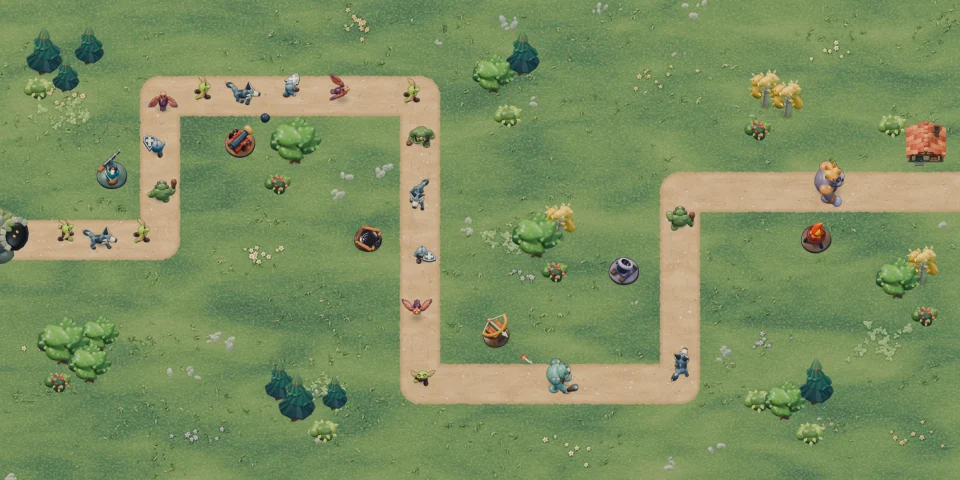

# Painted Meadow

**I’d play this Meadow on desktop and take the same art into a phone playtest.** At 32 px per cell I can follow a shot from the tower to its target and recognize the Wolf, Harpy and crowned boss without labels. At 20 px the six towers still separate by shape and colour. Small details go first, especially the mortar shell’s fuse and the cottage door.

**Keep the ground overhead and the pieces at 65° above the horizon.** In the matched 1× study, compare the Longbow’s post, the Troll’s stance and the spruce’s tiers. Those features gain height while their bases stay on exactly the same points. The bend retains its width in both pictures. I see no reason to lower the camera or shorten the figures. [Matched camera study](camera-study.webp)



## Views for the owner

| Scene | Full map at 1× and 2× | With the HUD space reserved | Phone at 20 px per cell |
|---|---|---|---|
| Before wave 1 | [960 × 480](meadow-before-map-1x.webp) · [1920 × 960](meadow-before-map-2x.webp) | [1×](meadow-before-1x.webp) · [2×](meadow-before-2x.webp) | [Portrait](meadow-before-phone.webp) |
| Mid-wave | [960 × 480](meadow-mid-wave-map-1x.webp) · [1920 × 960](meadow-mid-wave-map-2x.webp) | [1×](meadow-mid-wave-1x.webp) · [2×](meadow-mid-wave-2x.webp) | [Portrait](meadow-mid-wave-phone.webp) |

- Before wave 1, each of the six tower models stands on a buildable cell centre. The cave opens at (0, 240) and the cottage stands at (926, 150).
- Mid-wave stages 20 figures, including both bosses, to show the whole roster together. The Cannon fires toward a Shieldbearer and the Longbow toward Grumblefoot. Each tower aims at the furthest-along eligible enemy in range. This is an art composition. The current wave schedule does not put these two bosses together.
- The desktop frames reserve 100 px under the complete 1× map for the HUD, or 200 px at 2×. The portrait plate is 480 × 734 with a 300 × 600 map inset at (90, 54). That gives exactly 20 px per cell across the 15-cell width. The margins and HUD space are dark. Open at actual size to judge the silhouettes.
- The current game capture and the painted scene share a 32 px grid scale. The capture has its real HUD and its original wave. Its panel matches the tracked PNG pixel for pixel. [Side-by-side comparison](meadow-comparison.webp)
- The labelled contact sheet pairs a native 2× pose with its phone-size counterpart for every piece on neutral swatches. The bottom shows the ground at both scales. [Contact sheet](meadow-contact.webp)

## Delivery size

Exact file sizes in bytes. A player needs the assets for one density.

| PNG assets | 1× | 2× |
|---|---:|---:|
| Level-one towers | 231,487 | 756,568 |
| Enemies and bosses | 221,560 | 663,191 |
| Scenery | 28,824 | 92,820 |
| Projectiles and Harpy shadow | 3,068 | 8,880 |
| Ground | 646,438 | 1,765,839 |
| **All piece sheets, excluding ground** | **484,939** | **1,521,459** |
| **All shipping PNGs** | **1,131,377** | **3,287,298** |
| JSON alongside them | 5,471 | 5,491 |
| **Shipping PNG + JSON** | **1,136,848** | **3,292,789** |

Both densities together use **4,429,637 bytes** including JSON. The 13 WebP review plates add 3,214,570 bytes. All images committed for this slice together use **7,633,245 bytes (7.63 MB)**. Existing spike and game reference images are excluded.

| Asset | 1× PNG bytes | 2× PNG bytes | What reads at game scale |
|---|---:|---:|---|
| Musketeer | [42,581](../../../assets/art-painted/musketeer-1x.png) | [139,086](../../../assets/art-painted/musketeer-2x.png) | The offset steel musket extends past the blue hat, including when it points north. |
| Cannon | [36,942](../../../assets/art-painted/cannon-1x.png) | [124,355](../../../assets/art-painted/cannon-2x.png) | The long iron barrel and red wheels separate it from the squat Mortar. |
| Tar Pit | [33,590](../../../assets/art-painted/tar-pit-1x.png) | [110,904](../../../assets/art-painted/tar-pit-2x.png) | A low square timber crib holds a black pool. Its open side is the subtlest aim cue. |
| Longbow | [42,180](../../../assets/art-painted/longbow-1x.png) | [138,215](../../../assets/art-painted/longbow-2x.png) | The amber stave, pale string and nocked arrow make the widest tower silhouette. |
| Mortar | [38,609](../../../assets/art-painted/mortar-1x.png) | [121,479](../../../assets/art-painted/mortar-2x.png) | A lavender rim surrounds a deep, upward-facing bore. |
| Fire Pot | [37,585](../../../assets/art-painted/fire-pot-1x.png) | [122,529](../../../assets/art-painted/fire-pot-2x.png) | The orange flame and red bowl stay visible against the green and ochre. |
| Goblin | [19,359](../../../assets/art-painted/goblin-1x.png) | [57,467](../../../assets/art-painted/goblin-2x.png) | Wide ears and small dark feet carry the lime silhouette through the walk. |
| Wolf | [26,946](../../../assets/art-painted/wolf-1x.png) | [79,494](../../../assets/art-painted/wolf-2x.png) | The pale muzzle, backed ears and swept brush tail read in profile and head-on. |
| Troll | [27,037](../../../assets/art-painted/troll-1x.png) | [81,625](../../../assets/art-painted/troll-2x.png) | A heavy green torso and short brown club distinguish it from the small Goblin. |
| Harpy | [22,760](../../../assets/art-painted/harpy-1x.png) | [66,891](../../../assets/art-painted/harpy-2x.png) | The wine-red wings open and close above a separate shadow. |
| Shieldbearer | [19,241](../../../assets/art-painted/shieldbearer-1x.png) | [57,227](../../../assets/art-painted/shieldbearer-2x.png) | The blue kite shield carries a pale cross large enough to read on the phone plate. |
| Grumblefoot | [44,064](../../../assets/art-painted/grumblefoot-1x.png) | [132,352](../../../assets/art-painted/grumblefoot-2x.png) | The teal hide, broad stance and club mark the first boss. Its side view resembles a larger Troll. |
| Grumblemaw | [62,153](../../../assets/art-painted/grumblemaw-1x.png) | [188,135](../../../assets/art-painted/grumblemaw-2x.png) | The gold crown above the largest purple body makes it the quickest boss to pick out. |
| Cave mouth | [10,440](../../../assets/art-painted/cave-1x.png) | [32,977](../../../assets/art-painted/cave-2x.png) | Two upright views let the hollow open onto the route at the left edge or the top edge. |
| Cottage | [4,294](../../../assets/art-painted/cottage-1x.png) | [13,938](../../../assets/art-painted/cottage-2x.png) | The tiled gable and chimney mark the exit. The door is mostly a desktop detail. |
| Spruce | [2,752](../../../assets/art-painted/spruce-1x.png) | [9,243](../../../assets/art-painted/spruce-2x.png) | A dark flared skirt and a light pointed tip give it a stepped outline. |
| Oak | [4,311](../../../assets/art-painted/oak-1x.png) | [14,104](../../../assets/art-painted/oak-2x.png) | The broad overlapping crowns fill out the groves. Repeated copies are still apparent. |
| Birch | [3,417](../../../assets/art-painted/birch-1x.png) | [11,203](../../../assets/art-painted/birch-2x.png) | Yellow foliage on a pale trunk breaks up the darker trees. |
| Bush | [1,888](../../../assets/art-painted/bush-1x.png) | [5,877](../../../assets/art-painted/bush-2x.png) | A low pale mound stays distinct from the taller trees. |
| Berry bush | [1,722](../../../assets/art-painted/berry-bush-1x.png) | [5,478](../../../assets/art-painted/berry-bush-2x.png) | A few red berries punctuate the dark leaves. |
| Cannonball | [492](../../../assets/art-painted/cannonball-1x.png) | [1,349](../../../assets/art-painted/cannonball-2x.png) | A small round iron shot remains visible between Cannon and target. |
| Arrow | [455](../../../assets/art-painted/arrow-1x.png) | [1,321](../../../assets/art-painted/arrow-2x.png) | A warm shaft connects the pale point and red fletching. This is the thinnest shot. |
| Mortar shell | [650](../../../assets/art-painted/mortar-shell-1x.png) | [1,801](../../../assets/art-painted/mortar-shell-2x.png) | A fuse and ember identify the shell at 2×. The ember is a speck at phone size. |
| Tar glob | [559](../../../assets/art-painted/tar-glob-1x.png) | [1,607](../../../assets/art-painted/tar-glob-2x.png) | A dark, trailing glossy drop breaks the round silhouette of the cannonball. |
| Flame | [494](../../../assets/art-painted/flame-1x.png) | [1,382](../../../assets/art-painted/flame-2x.png) | A single warm tapered tongue stays visible even as a small shot. |
| Harpy shadow | [418](../../../assets/art-painted/harpy-shadow-1x.png) | [1,420](../../../assets/art-painted/harpy-shadow-2x.png) | A separate soft oval sits at the Harpy’s ground position. |
| Meadow ground | [646,438](../../../assets/art-painted/meadow-1x.png) | [1,765,839](../../../assets/art-painted/meadow-2x.png) | A brush-stippled pasture, broken wheel ruts, clover, small stones and eleven flower beds follow the full route. |

## Wiring the art

- Render the opaque ground at world origin with a 960 × 480 logical footprint. A camera straight above Meadow preserves the 30 × 15 build grid. The trail follows the seven straight segments, round outer corners and square inner corners. The visible edge stayed within one logical pixel of the intended 20 px radius in both files.
- Read the JSON next to each PNG. `frameSize` and `anchor` use **pixels in that density**, with (0, 0) at the top left of the frame. Every pose in a sheet has the same anchor. For frame index `i`, take column `i % columns` and row `floor(i / columns)`. Set the sprite’s origin to `(anchorX / frameWidth, anchorY / frameHeight)`. For example, the 1× Musketeer is 50 × 50 with its ground pivot at (25, 31).
- Set display dimensions to the source frame dimensions divided by its density. A 64 px cell in a 2× texture occupies 32 logical world pixels. A projectile’s anchor is its flight position. Draw the separate Harpy shadow first at the same ground anchor as the Harpy. The model already includes its flight height. Other grounded pieces have a centred soft contact shadow and projectiles have none.
- All six level-one towers use **16 headings**. The new long musket made 45° changes conspicuous at phone scale. The extra headings halve the step to 22.5°. Read eight frames across and then the second row, clockwise from N through NNE, NE, ENE, E and onward. Snap the **screen-space** aim vector to the nearest bearing. The single arrow image points north and rotates about its anchor during flight.
- Every enemy and both bosses have four phases across and four rows down, in N, E, S, W order. A ground-contact pivot stays fixed while the feet, arms or wings cycle. Use the game’s movement clock to advance the phase. The cave has an east-opening cell for landscape and a south-opening cell for portrait. The other scenery and projectile sheets each have one frame.
- For portrait, turn the ground clockwise and transform each world anchor to `(480 − y, x)` before display scale and HUD offset. Add 4 tower headings or 1 enemy row modulo the count. Draw the selected miniature upright. Keep the ground and scenery behind the figures, sort overlapping figures by screen base Y, and draw shots above them.
- Use linear texture filtering with alpha-correct compositing. The cell gutters are transparent. At 1× and 2× use the matching native texture. For the phone mock, the compositor filters from 2×. Preserve the existing simulation positions, ranges, build checks and drawing layers when wiring the switch.

## Rebuild and verification

Run from the art worktree on this Mac.

```sh
python3 scripts/art/build_slice.py
```

The entry point runs Blender 4.5.11 LTS headless for the geometry, paint, lighting and contact shadows. The board uses Cycles at 16 samples and the pieces use EEVEE at 32. The same upper-left key lights both. The host Python and Pillow pack and composite the PNGs. The ground export rounds each colour channel by at most one 8-bit step. Raw frames and timing output stay in `/private/tmp/tarpit-art-scratch`.

| Measured stage on this Mac | Seconds |
|---|---:|
| 16 camera-study renders, with setup and file writes | 3.31 |
| Ground, with setup and file write | 8.76 |
| 222 native cells, sheet packing and both PNG densities | 67.90 |
| Full-map mocks, contact sheet and current-game comparison | 3.16 |
| **Complete command, including ground export and camera plate** | **84.80** |

The ground render call alone took 8.216 seconds. I inspected the ground, each packed pose at both densities, the camera comparison and all review plates. Checks covered 54 matching PNG/JSON pairs, all 444 sprite cells, transparent padding, fixed anchors, exact 2-to-1 frame and anchor scaling, frame orders, the trail boundary through all bends, six legal tower cells, the actual aim targets, output dimensions and the unchanged reference panel. The brief excludes game tests. Animation in the running game and visibility on a physical handset remain unverified.

## Where a human hand would help

The field still shows an even dry-brush grain, and recurring tree crowns give away the stamps. The Troll and Grumblefoot share rounded shoulders and a similar club swing. An artist could put more weight into Grumblefoot’s planted leg, give the Troll a more crooked back, and paint a few distinctive edges into the groves. Those refinements matter more than extra tower angles now.

Next logical thing: Kyle can judge the portrait mid-wave frame and decide whether to wire this Meadow behind the art switch.
