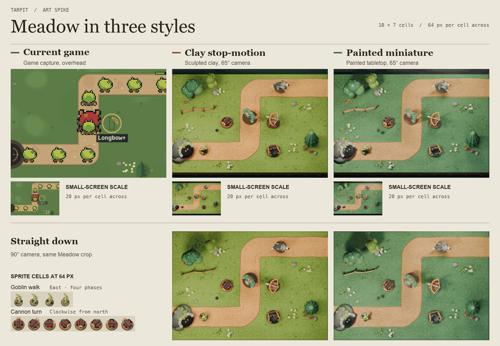

# Meadow art study

Kyle chose the painted miniature finish in this study. A 65° camera brings
out wheels, faces and the side of the Cannon. The lower row shows the same
Clay and Painted boards overhead. The phone-size samples use 20 px per cell.
The board, poses and turn study are from the original prototype.



The study compares the first two bends of Meadow. The large panels use
64 px per cell across. The bottom section also shows four Goblin walk poses
and eight Cannon bearings. The 2,056 × 1,425 sheet uses an indexed palette
for a smaller download. The [Painted Meadow review](../slice-meadow/README.md)
shows the complete later set.

## Rebuild

Use Blender 4.5, a host Python 3 with Pillow 11.3, and FFmpeg. Blender and
FFmpeg are found on `PATH` or in their standard macOS install locations.

```sh
python3 scripts/art/build_spike.py
```

Set `TARPIT_ART_SCRATCH` to choose the scratch directory. Its default is
`/private/tmp/tarpit-art-scratch`. The full rebuild writes the 64, 32 and
20 px board plates, both detail images and both 2× animation proofs under
`spike-v5/` in scratch. It also writes the 1× sprite proofs under `sheets/`.
Pass `--pack-only` to reuse the raw board and sprite renders. Review text
uses macOS fonts when available, then DejaVu, then Pillow's default font.
The comparison rebuild uses the tracked Classic capture in the checkout.
