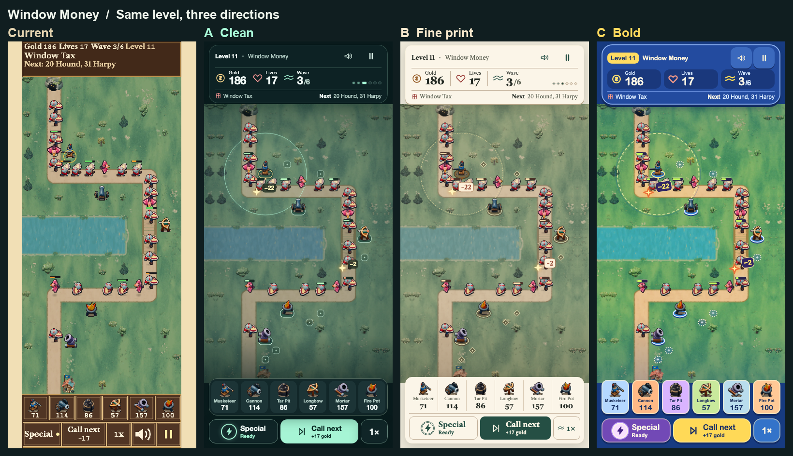

# Tarpit look directions

[Open the full-size contact sheet](contact-sheet.png)

All three show **Window Money**, Level 11 on Riverbend. The current screen is a capture of the game with a staged Wave 3 crowd. The mock-ups use the same board, crowd, towers and prices. The card shows a previous two-star best and the result shows a new three-star win.

| Direction | Mid-wave, phone | Mid-wave, landscape | Upgrade | Level card | Result |
|---|---|---|---|---|---|
| A · Clean | [390 × 844](a-clean-01-mid-wave.png) | [960 × 580](a-clean-01-mid-wave-wide.png) | [Open](a-clean-02-upgrade.png) | [Open](a-clean-03-level-card.png) | [Open](a-clean-04-result.png) |
| B · Fine print | [390 × 844](b-fine-print-01-mid-wave.png) | [960 × 580](b-fine-print-01-mid-wave-wide.png) | [Open](b-fine-print-02-upgrade.png) | [Open](b-fine-print-03-level-card.png) | [Open](b-fine-print-04-result.png) |
| C · Bold | [390 × 844](c-bold-01-mid-wave.png) | [960 × 580](c-bold-01-mid-wave-wide.png) | [Open](c-bold-02-upgrade.png) | [Open](c-bold-03-level-card.png) | [Open](c-bold-04-result.png) |

## A · Clean

Soft dark panels, mint accents and plain sans-serif type put the road and the numbers first. The King's tax, crown and Redcoats carry the 1776 theme. **Medium** to build. The expensive parts are making the translucent panels legible on every map and refitting the HUD and menus for smaller phones. Gold, lives and wave are easy to scan, and children get short labels alongside the icons.

The upgrade panel would glide up and settle while the range ring fades in. Buttons would compress a little on touch and release quickly. A hit would flash once and lift the damage number while gold rolls to its new value without shifting the layout. The battle camera would stay steady while you aim, with a gentle settle when entering the level.

## B · Fine print

Cream paper, ink and a small royal seal make the King's orders feel printed. The 1776 theme comes through in the typography, the town's reply and the shape of the notice. **Small** to build using the existing Caslon font and screen structure, with most of the effort in wrapping long tax notices and keeping the paper HUD readable in both layouts. The cards give phone readers clear sections, though children will have more to read than in A or C.

A card would slide in like a sheet being laid down, with a quiet shadow as it settles. Buttons would darken and sink a pixel under a finger. A hit would flick a few gold sparks and stamp the damage number briefly, while counters change in place. The camera would hold its framing throughout the wave.

## C · Bold

Blue, mango and lavender make each action feel like a toy button. The notices, crown, coats and town keep the revolution in view. **Large** to build across the game because the icon set, feedback animations and colour contrast need to work together on every map, especially the dark Keep. The large controls and bright prices help children pick out actions quickly, with labels to help when colours are hard to tell apart.

The panel would rise and settle with one small bounce. Buttons would press into their bases and spring back. A hit would pop as a short starburst, and the gold total would swell once when it changes. The camera would ease in at the start of a wave and hold during play so the road stays easy to follow.

## What I’d pick

Start with **A’s battle HUD and B’s level cards and results**. A makes the busiest screen easier to read. B gives the King and the town more character in the moments where there’s time to read. C’s clear ready state and button press could work with either. Keep the painted terrain, clear road, recognizable towers and enemies, town art and dry replies in any direction.

[Compare the Cannon, Redcoat Shieldbearer and Royal Harpy](sprite-comparison.png) at 390-wide phone size in DPR 3 physical pixels and at 2.4× enlargement. The smoother Blender renders use the existing models and match the shipped body sizes. The mock-ups use today’s sprites so the UI choices can be judged independently. The panels and effects shown here are stills, and the motion above is proposed.

The mock-up sources are under [scripts/art](../../../scripts/art/). Type is Helvetica Neue for A, the repo’s Libre Caslon Text with Georgia headings for B, and Arial with Arial Rounded MT Bold headings for C.
